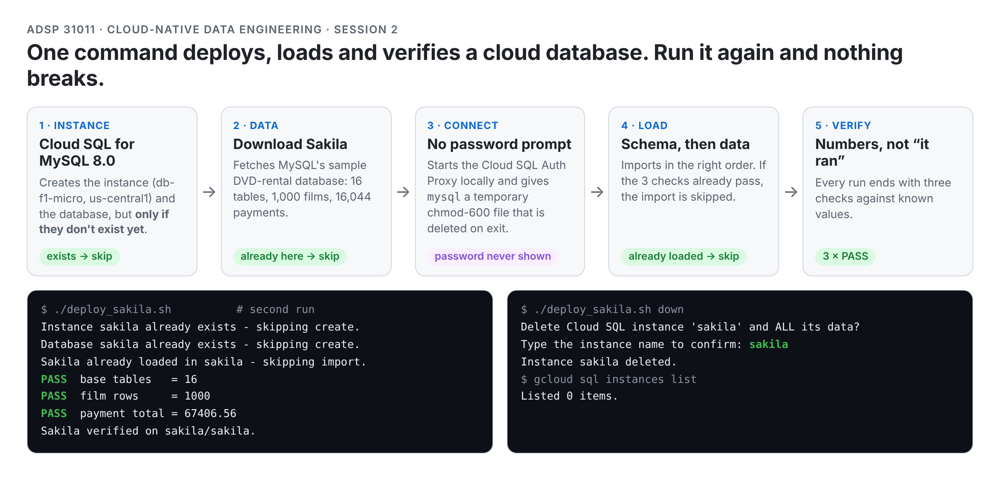
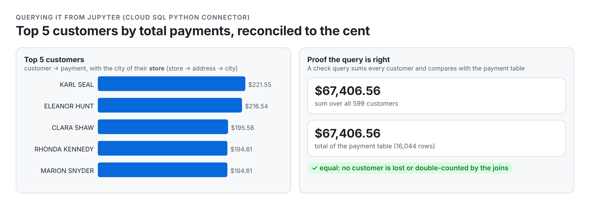

# Cloud SQL Sakila Deploy

**One command stands up a MySQL 8.0 database on Google Cloud SQL, loads the Sakila sample database, and proves it loaded correctly; one more command tears it down. It's safe to re-run, and the password never appears on screen, in a file or in a prompt.**

[Sakila](https://dev.mysql.com/doc/sakila/en/) is MySQL's sample DVD-rental database: 16 tables, 1,000 films, 16,044 payments. The point of this repo is not the data. It is the discipline around it: an idempotent infrastructure script, credentials that live only in the environment, verification by numbers instead of "it ran", and a data dictionary a new analyst can trust.

## The idea in one picture

<picture>
  <source media="(prefers-color-scheme: dark)" srcset="assets/deploy-flow-dark.png">
  
</picture>

## What's in here

| File | What it is |
|---|---|
| `deploy_sakila.sh` | The idempotent deploy / verify / teardown script (`set -euo pipefail`) |
| `LinuxCommands.sh` | Every Linux and `gcloud` command I ran by hand first. The script was built from this |
| `sakila_notebook.ipynb` / `.html` | The same database queried from Jupyter through the Cloud SQL Python Connector, including the top-5-customers query and a check that reconciles it to the payment total |
| `sakila_dictionary.md` | Data dictionary: all 16 base tables (primary key, foreign keys with constraint names, what one row means) and the five relationships a new analyst must know |
| `env.example.sh` | The variables the script needs (copy to `env.sh`, which is git-ignored) |
| `prompts.md`, `CLAUDE.md` | AI disclosure: every prompt to Claude Code / Cowork, what was wrong, and the rules I gave the agent |

## Quickstart (Google Cloud Shell)

```bash
cp env.example.sh env.sh && nano env.sh     # fill in project, region, instance, password; never commit env.sh
source env.sh
chmod +x deploy_sakila.sh
./deploy_sakila.sh            # create (≈10 min the first time), import, verify
./deploy_sakila.sh            # run again: everything is skipped, verification still runs
./deploy_sakila.sh down       # delete the instance (asks you to type its name)
```

Needs `gcloud`, `cloud-sql-proxy` and the `mysql` client (all preinstalled in Cloud Shell). Cost: db-f1-micro is about a cent an hour, so delete when done.

## Things I hit that tutorials don't mention

- **The brief's numbers were from an older Sakila.** The current download has 16,044 payments totalling 67,406.56, not 16,049 / 67,416.51. A mismatch means re-import, never "fix" rows (confirmed with the instructor).
- **`gcloud sql connect` prompts for the password every time**, which kills automation. The script runs the Cloud SQL Auth Proxy locally and gives `mysql` a temporary `chmod 600` option file that a `trap` deletes on exit, so there's no prompt and nothing left on disk.
- **`--root-password` still puts the password on the command line** during `instances create`. That's the one remaining exposure, noted rather than hidden.
- **Import order matters:** `sakila-schema.sql` first (it drops and recreates the schema), then `sakila-data.sql`.
- **An allow-list beats a written rule.** CLAUDE.md said "run nothing before I approve", but `.claude/settings.json` allowed `bash -n *` and `ls *`, so Claude ran them without asking. They were read-only, but the lesson is that permissions live in config, not prose.
- **The AI over-generalised once:** the dictionary draft claimed every table has a `last_update` column. `film_text` doesn't (15 of 16). Caught by grepping the schema; recorded in `prompts.md`.
- **The city of a customer's *store*, not of the customer.** The top-5 query joins `store.address_id`, not `customer.address_id`, an easy silent bug.

## Verified, not assumed

<picture>
  <source media="(prefers-color-scheme: dark)" srcset="assets/top-customers-dark.png">
  
</picture>


- Script: no password in the file (`grep -cF -- "$MYSQL_ROOT_PW" deploy_sakila.sh` → 0); a re-run against an existing instance skips every create and import and still prints three PASS lines.
- Top 5 customers by payments: KARL SEAL 221.55 · ELEANOR HUNT 216.54 · CLARA SHAW 195.58 · RHONDA KENNEDY 194.61 · MARION SNYDER 194.61. The sum over all 599 customers equals the payment table total, 67,406.56.
- Teardown: `gcloud sql instances list` → `Listed 0 items.`

## Context

Built for **ADSP 31011 Cloud-Native Data Engineering** (UChicago MS in Applied Data Science, Autumn 2026). Published with the instructor's permission to showcase the work. Sakila is © Oracle (BSD license) and is downloaded by the script, not stored here.

**Hao Kang** · [LinkedIn](https://www.linkedin.com/in/hao-kang-6654b5331/) · [GitHub](https://github.com/haokang-uchicago)
